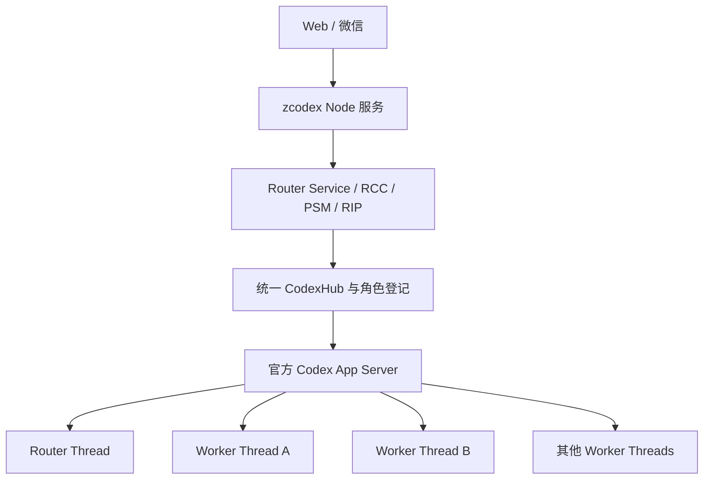

# UAS：Codex CLI Web 统一官方 App Server 改造设计

## 1. 项目背景与改造原因

项目：`TiChuXiXi/codex-cli-web`，目标分支 `feature/router`。实际实施以当前工作树为准，不假定旧提交仍是最新版本。

项目从 Codex CLI Web 工作台逐步发展为统一智能工作入口，现有能力包括 Web、Router（中枢）、Worker、RCC（可靠通信与控制）、PSM（项目与会话认知索引）、RIP（身份与人格）、微信 iLink、统一待办、原生审批、事件回执以及工作环境只读查询。正在推进或已存在的 zcodex npm 发行及生命周期管理能力也应保留，具体完成情况须核查源码。

Router 的职责是聊天、工作环境查询、目标定位、指令转接、控制与反馈；Worker 负责项目业务分析、规划和执行。Router 不需要额外长期业务记忆，PSM 用于历史定位。RCC 保证原始指令可靠送达，支持实时 Steer、延迟投递、多 Worker 并行、取消、中断、纠正及恢复。RIP 不改变权限。聊天模式禁止自动业务派发；任务模式业务请求交给 Worker，但允许 Router 直接回答有证据的工作环境只读查询。模式、渠道焦点和任务状态由服务端维护。

### 1.1 当前架构及历史原因

早期为了限制 Router 的工具、文件访问及执行权限，采用定制编译的 codex-router、独立 CODEX_HOME、专用启动器和官方 Worker App Server。此前方案使用过精确的 12 工具白名单、策略 v2、Linux 隔离启动器，并考虑 Windows 原生隔离。实际工具数量、策略版本和运行方式须以当前源码核实。

这种设计导致两套运行时、协议和版本维护，增加 npm 发行、Windows 支持、安装与升级成本。用户实际遇到 Worker 升级后 Router 无法派工。用户提供的故障分析指出 dispatcher.js 中 supportsQueue()、supportsSteer() 依赖固定版本白名单；需在当前源码及日志中复核，不能把版本不同本身视为已经证实的唯一根因。

### 1.2 改造目的

优先让 Router 和 Worker 共用同一个官方 Codex App Server，以独立 Thread 管理上下文。移除定制编译依赖，降低维护成本；解决未来官方版本升级导致的派发阻断；保留全部现有业务能力、权限、数据及微信绑定。支持原生 Windows、Linux x64/arm64 和 WSL，分平台验证，不将 WSL 当作原生 Windows 的验收证据。

## 2. 架构选择与不可妥协边界

目标 A：一个官方 App Server，Router Thread 与多个 Worker Thread 共享连接管理、进程和官方运行时。

备选 B：两个官方 App Server，使用同一受控官方 Codex 安装及版本，保留独立进程和必要的 CODEX_HOME、OS 隔离。此方案仍须验证工具限制，不能仅凭独立进程宣称安全。

过渡 C：保留现有定制 Router，独立修复 Worker 协议兼容；当 A/B 无法维持必要边界时使用。不得静默降低安全性以完成迁移。

图为目标 A，不代表官方协议已经证明支持所需隔离。共享进程不意味着共享上下文或权限。保留用户已有 Worker 权限、审批及模型设置；Router 不得直接执行项目命令、修改文件、调用未授权工具、绕过 Dispatcher 或访问不应读取的宿主数据。提示词、只读沙箱名称、动态工具注册均不能单独证明工具白名单或隔离成立。

## 3. P0：官方能力与安全可行性验证

先阅读 AGENTS.md、架构文档、RCC/PSM/RIP/NDC 及相关验收记录，检查 Git 状态并保留用户改动。记录实际官方 Codex 版本、安装路径、App Server 传输、协议定义、运行时配置和当前 Router 定制差异。使用临时项目、独立 CODEX_HOME、隔离 App Server、无真实凭据的夹具开展验证；需要真实模型时使用明确授权的测试账号。不得用生产任务探测协议。

| 验证项 | 必须取得的证据 |
|---|---|
| 多 Thread | Router 与至少两个 Worker 同时运行，独立上下文、模型、推理强度、cwd 和设置 |
| 动态工具 | 注册、调用、回传、恢复后工具定义及归属正确；核实实际可用工具集合 |
| 工具限制 | 尝试 Shell、文件修改、未授权 MCP、子 Agent、间接执行及越权访问；证明被禁止或由可信边界阻断，而非仅模型拒绝 |
| 文件与网络 | 验证 Router 无法读取 Worker/Codex Home、用户工程、工作台数据库及凭据等原本禁止的资源；不能绕过 Node 服务调用宿主 RPC 或 Worker 控制接口 |
| 权限生命周期 | thread/start、resume、turn/start、steer、重连、上下文压缩及主会话切换后仍有效；高权限 Worker 不影响 Router |
| 外部客户端 | 官方 CLI/Desktop 或其他连接不能借恢复 Router Thread 改写其权限、冒充 Router 或绕过角色控制；核实实际信任边界 |
| 原生队列 | add/list/start/delete、忙时行为、自动消费、恢复、队列身份及重复提交行为 |
| Steer | 正常运行、审批等待、原生输入等待、Turn 边界、ACK 丢失、中断后历史可见性 |
| 审批及事件 | 多 Thread 并发审批、输入、动态工具、完成事件正确关联，不串线 |
| daemon 与平台 | 重连、恢复、进程归属及原生 Windows/Linux/WSL 差异；共享 daemon 的能力与私有 stdio 分别记录 |

必须核对上游源码和协议定义，并实际运行正向、负向实验。对每项标注已实测、源码推断、未验证或不支持，保存版本、请求响应及脱敏证据。不要假设存在某个官方工具限制字段或能力协商接口。

放行规则：A 满足所有必要边界则选 A；否则验证 B；B 仍不满足则保留 C 并说明差距。不能证明隔离时不得上线该架构。无需等待用户确认即可继续安全的隔离验证及独立兼容修复；需要放宽权限、改变用户要求或进行不可逆生产操作时暂停。将结论和逐文件计划写入 `docs/ROUTER_UNIFIED_APP_SERVER_PLAN.md`。

## 4. P1：独立修复版本兼容（不依赖统一进程成功）

审查 `server/router/dispatcher.js` 的 supportsQueue()/supportsSteer()、Hub 适配和已有 RCC 测试。优先采用官方明确的能力协商；其次使用当前连接的已验证协议能力、适配器及兼容记录。固定版本表只能辅助，不能成为未知版本一律拒绝派工的唯一理由。没有能力协商时，使用隔离探针或可证明无副作用的查询；无法证明安全的操作保持未验证状态。

按能力分别判断 queue、steer、interrupt、历史读取等，不将一个接口失败扩大为全部功能不可用。连接重建、版本或协议身份变化时重新验证缓存。明确不支持的操作应有安全降级（例如空闲后续接），不能安全降级则报告具体原因、版本、受影响能力和恢复入口；不能无限静默排队。

保留 RCC 先落库、每 Worker 有序、跨 Worker 并行、原文传递、幂等、取消和 unknown 对账。此前 0.170.0 实验表明相同 clientUserMessageId 并不保证原生去重，且 Steer ACK 不等于模型实际消费；本轮须复核目标版本。结果未知不得通过更换接口、重新入队或重试盲目发送。仅明确未接收或明确拒绝且可安全转换时才切换投递方式。未知状态有界对账及人工处置，不阻塞无关 Worker、审批、状态查询和紧急控制。

验收：旧版本、已验证新版本、未知版本、缺失单项能力、明确拒绝、超时及断线均有测试；官方升级后兼容能力可用时继续派工，不可用时明确降级或报错，无重复或静默丢失。

## 5. P2：统一连接、Thread 角色及事件管理

在 P0 放行的架构上复用现有 CodexHub、Dispatcher、RouterStore、EventBus 和 Wake。目标 A 下 Hub 为唯一 App Server 连接与生命周期入口；目标 B 则由统一管理层明确区分两个官方连接，不能伪称单进程。

建立持久化 Thread 角色登记，包含运行时/连接身份、Thread ID、角色、当前或历史 Router 标记及必要版本。不得以标题、模型或 cwd 推断角色。启动、恢复和重连时先登记及核验，再接收业务事件；身份不明的事件不得触发有副作用操作。事件、请求及回包按连接代次、threadId、turnId、itemId、requestId/instanceId 等实际协议身份核验。

Router 动态工具只允许已登记 Router 的有效回合调用，保留精确工具参数、调用预算、授权及回执批次约束。Worker 保留原生审批和用户输入。Router Thread（含历史及相关内部 Thread）不得成为 Worker 候选、PSM 业务索引来源、Worker 终态回执来源或派发目标，防止递归。未知角色不自动升级为 Worker。共享进程故障时统一恢复，但各 Thread 的状态和任务归属仍独立。

保留聊天/任务模式、各渠道焦点、只读查询、RIP、PSM 权限、RCC 队列及微信待办语义。Router 完成自身转接回合不等于 Worker 完成。Worker 完成仍通过现有事件唤醒 Router，并按原有机制去重。

保留 Router 模型与推理强度、Worker 原有 Thread 配置。不得为了共用进程覆盖 Worker 权限或将其切换到 Router 模型。明确 daemon 与 stdio 的进程所有权：停止 zcodex 不应终止外部拥有的 daemon；自有进程关闭前处理持久状态并明确任务影响。

## 6. P3：数据、历史与配置迁移

迁移前盘点实际状态目录、数据库 schema、加密密钥、Router/Worker CODEX_HOME、运行时安装、主会话指针、角色记录及在途任务。不得将旧路径硬编码为新版本路径。

| 数据 | 要求 |
|---|---|
| Worker 原生历史 | 原 Thread ID、历史、项目归属保持不变 |
| Router 历史 | 完整保留、可查询和展示；不强制物理迁入官方 CODEX_HOME |
| router.sqlite、RCC | 保留任务、指令、派发键、回执、unknown、待办、模式、焦点及授权 |
| PSM | 保留索引、用户确认、修订及项目身份；不得重新扫描 Router 历史为业务记录 |
| RIP 与用户配置 | 保留现有设置、revision、模型和通知偏好；旧配置兼容 |
| 微信 | 保留 wechat.key、绑定凭据、账号代次、游标、inbox/outbox、消息及交互记录 |

若官方有可靠且经过验证的历史迁移方式，可采用；否则保留旧 CODEX_HOME 和旧 Router Thread 为只读历史，复用已有主会话切换机制创建官方 Router Thread。恢复服务端配置、模式、焦点、授权及 PSM。新 Router 不需要继承完整业务上下文。不得直接篡改官方内部会话文件或伪造历史 ID。

迁移采用版本化、幂等、可恢复的状态机：盘点与预检 → 停止接纳新工作 → 安全收束 → 一致备份 → 准备并验证新运行时/Thread → 原子切换主指针 → 维护模式检查 → 恢复服务。切换前检查活跃 Router、在途 RCC、待处理审批、输入、延迟回执和微信发送。外部 Worker 若继续执行须保留归属并对账；无法恢复的原生审批实例明确失效，不伪造、不自动批准、不重放。不能确认安全时延后切换。

使用 SQLite 一致备份（包含 WAL 已提交数据）及状态目录副本，保留旧运行时和配置。记录迁移版本、旧新主指针、阶段和故障恢复入口，不记录明文凭据。副本验证 schema、完整性、行数/关键身份、加密凭据可解密性及重复执行。旧历史访问继续受原授权约束。

回退边界：新运行时尚未恢复外部副作用时可恢复旧配置及一致快照；已派发或发送消息后不得盲目恢复旧快照覆盖新事实，须保留新记录并进行对账、兼容恢复或人工处置。生产迁移前明确备份、停机窗口和回退条件；不因自动化通过就擅自操作生产。

## 7. P4：微信兼容与恢复

不改变绑定身份、密钥、凭据及账号代次，不要求用户重新扫码。迁移后恢复原 iLink 连接和消息游标，Web 与微信共享新 Router 主会话，保留渠道焦点。入站去重、出站幂等、审批展示版本、待办身份、正在输入状态、RIP 表达和长消息策略均保留。

真实验收：使用明确指定的已有测试绑定，在迁移前后验证同一账号无需扫码；关闭 Web，通过微信查询项目、选择目标、派发任务、连续补充、处理审批及业务输入，收到真实结果。重启后恢复待办与消息；验证旧审批失效、未知投递不盲重发、多 Worker 并行和重复收件。实际手机收件证据不能由 outbox 状态或模拟夹具代替。若凭据本身已过期，明确区分既有凭据失效与迁移破坏。

## 8. P5：简化 zcodex 安装与发行

仅在官方运行时、安全边界、迁移、微信闭环通过后清理定制 Router 编译、二进制准备、启动器、废弃配置及相关 CI。备选 B 如仍需 OS 隔离则保留必要启动机制，不得一概删除。旧版本迁移和恢复入口在支持期内保留；历史数据不得随清理删除。

目标安装体验：用户独立安装并登录官方 Codex CLI，再 npm 全局安装 zcodex，执行 init/start。工作台更新与 Codex CLI 更新分离。复用现有 npm 包及生命周期管理，不引入 Electron、Docker、强制 PM2 或自动开机自启。更新 doctor、版本诊断、帮助、README、部署文档和架构图；旧专用运行时配置给出迁移说明。保留现有状态目录解析和认证，默认本地监听。

发行前从最终 tarball 在无源码、无 Rust/前端构建工具的干净环境验证。Windows 原生、Linux x64/arm64、WSL 分别记录。未验证的平台不得宣称正式支持。正式 npm 发布、真实生产部署不包含在自动授权的隔离开发范围内。

## 9. 逐文件审查指引

以下是候选改动点，先核查当前代码，不要求按名称新建重复模块。

- `server/codex/hub.js`、`server/codex/transport/`：连接、能力、Thread/Turn 归属、队列/Steer、恢复与进程所有权。
- `server/router/app-server.js`：移除或适配独立运行时，Router Thread 创建恢复、动态工具及每轮身份上下文。
- `server/router/service.js`、`tools.js`、`dispatcher.js`、`wake.js`：角色检查、RCC 投递、回执、模式与焦点、只读查询及授权。
- `server/router/store.js`、`psm.js`、`psm-sync.js`、`psm-migration.js`：角色持久化、历史保留、迁移和索引排除。
- `server/channels/wechat/`：绑定恢复、待办及消息对账，保持现有投递语义。
- `server/config.js`、`server/bootstrap.js`、`bin/zcodex.mjs`、现有 lifecycle 模块：配置兼容、进程启停、迁移及诊断。
- `shared/`、Web Router 设置和版本页面：运行时、能力、迁移状态及明确错误展示，不重做 RIP UI。
- `scripts/prepare-router-codex.mjs`、专用启动器及发行 CI：通过放行后再清理或保留兼容入口。
- `test/`、`scripts/test-router-protocol.mjs`、`scripts/test-wechat-live.mjs`、`docs/acceptance/`：协议、回归、迁移、真实验收及证据。

## 10. P6：完整验收矩阵

| 场景 | 通过条件 |
|---|---|
| 进程与 Thread | 目标 A 为一个官方 App Server；B 明确为两个官方进程；无定制编译依赖才可声明移除成功 |
| 权限负向测试 | Router 无法越权执行、读取或调用；高权限 Worker 不影响 Router；恢复后仍有效 |
| 角色与事件 | 不串审批、不自派发、不索引 Router、不重复回执；多客户端与重连正确 |
| RCC | 正常/审批/输入等待时补充，Turn 边界、取消、中断、unknown、崩溃恢复及并行不丢失不盲重发 |
| 版本升级 | 支持能力继续派工；不支持时明确降级或报错；未知版本不因白名单一律阻断 |
| 模式与查询 | 聊天不派发，任务模式可靠转交，只读查询不创建任务或改变焦点，混合请求不漏项 |
| PSM/RIP | 证据、授权、历史定位、人格和预览均保持原行为 |
| 数据迁移 | 副本重复迁移、故障点恢复、旧历史可读、Worker Thread ID 不变、数据及密钥完整 |
| 微信 | 原绑定无需扫码、手机独立完成任务闭环、待办恢复、真实结果及消息去重 |
| 生命周期 | 安装、启停、升级、重连及普通卸载保留数据；不误终止外部 daemon |
| 平台 | Linux x64/arm64、原生 Windows x64、WSL 分别验证；未执行项单列 |

执行项目现有单测、集成、typecheck、build、Playwright、协议探针和最终包安装测试，以实际 package.json 命令为准。补充针对性测试而非只依赖旧测试数量。记录版本、平台、测试条件、通过/失败/跳过、实际截图或日志和未验证事项。真实账号、模型和手机验收与模拟测试分开签收。

## 11. 执行约定与最终交付

新会话先阅读项目规范和本文，保留用户已有修改。直接开展 P0 隔离实验，输出 `docs/ROUTER_UNIFIED_APP_SERVER_PLAN.md`，包含实际源码根因、协议证据、A/B/C 选择、逐文件计划、迁移和回退方案。满足放行条件后直接继续 P1–P6，无需逐阶段等待确认；每阶段运行对应测试并记录。P0 受阻时仍可独立完成 P1。禁止降低权限边界、伪造验收、盲目重放或删除旧数据。生产迁移、真实账号操作和 npm 发布须有明确授权及备份放行。

最终交付：完整源码改造、架构与实施文档、能力矩阵、迁移回滚机制、安装升级说明、自动化和真实环境验收报告、明确的未完成项及阻塞原因。

最终成功标准：在经验证的官方架构下，Codex CLI 升级后依据实际协议能力可靠派工，原有 Worker 会话、任务、PSM、RIP、授权和微信绑定继续使用；用户无需重新扫码。优先实现单进程，但消除定制依赖和保持权限、数据及可靠交付比进程数量更重要。

本文依据用户提供的改造方案和此前架构讨论整理，未独立运行当前官方 Codex 或核验最新源码；所有官方能力、版本差异及平台可行性以 P0 实测为准。
