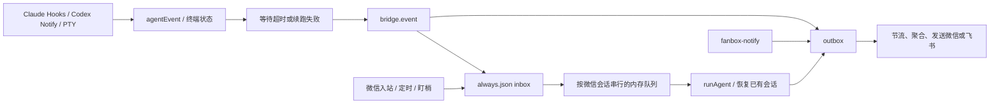
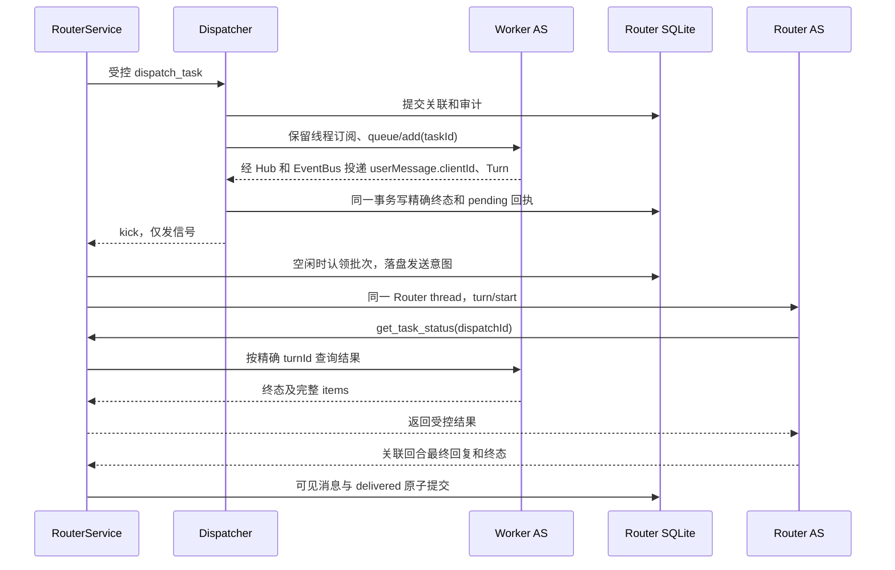
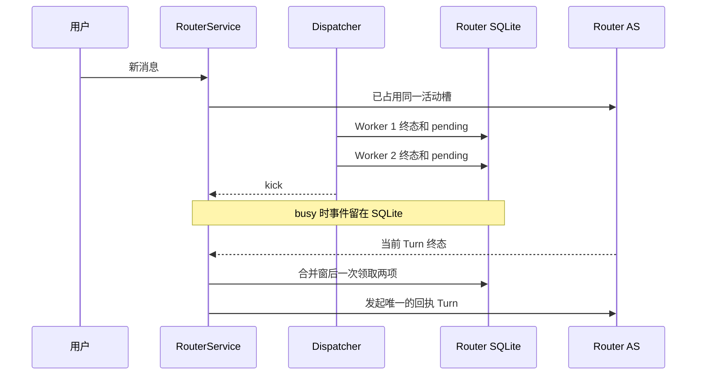
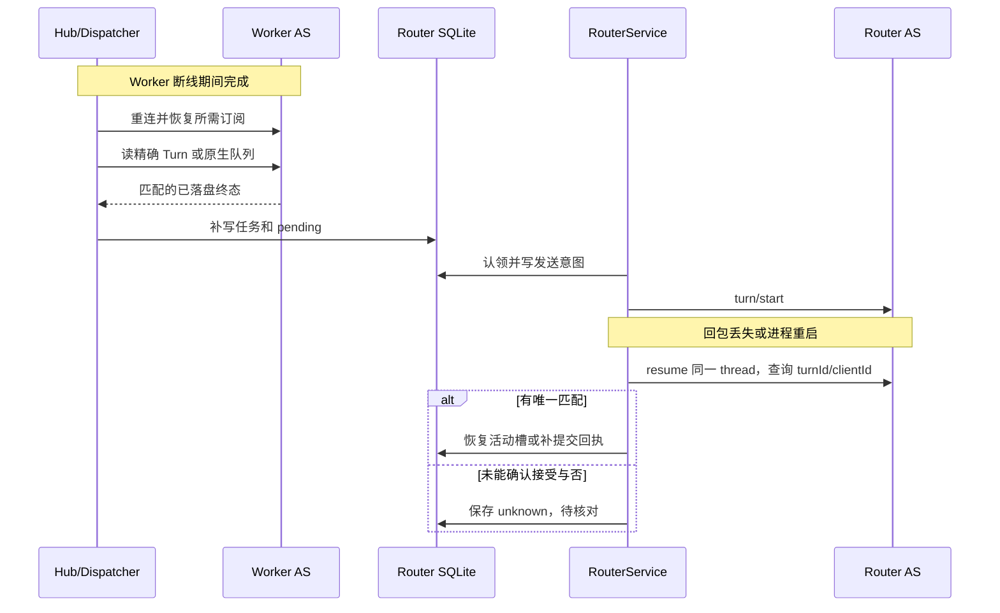
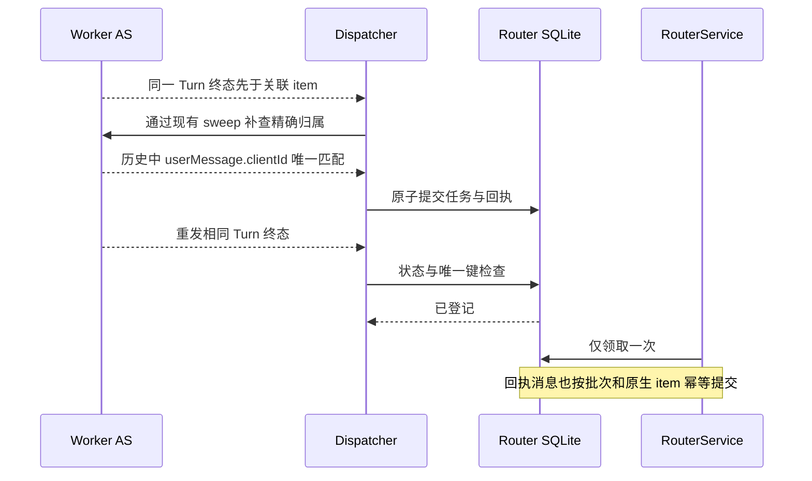

# Router 自动唤醒闭环研究与实施设计

研究日期 2026-11-18。实施范围为设计和验收计划。

## 结论

**推荐方案 B。复用现有 Hub → EventBus → RouterDispatcher 链路，在任务进入已关联的 Worker 回合终态时，同一个 SQLite 事务写入待回执记录。由 RouterService 的单会话调度器在空闲时批量唤醒原 Router 会话。** Worker 回合、任务状态和 Router 回执各自对账。首版自动回合可读关联任务结果并汇报，后续派发由用户新消息触发。**【架构建议】**

项目已经能在后台关联 Worker 回合、记录终态、在面板显示任务变化。缺口是任务终态没有可靠交接给 Router 模型。Worker 原生队列、Web 后续消息队列与 Router 自己的回合入口各有职责。首版增加一张回执表、一个调度器，复用现有 SQLite、任务记录、受控工具和消息快照。**【本仓库源码】【架构建议】**

本文标记 **【FanBox 源码】**、**【本仓库源码】**、**【通过测试】**、**【架构建议】**、**【尚待验证】** 分别对应证据类型。**【上游源码】** 指锁定版本的 Codex 官方源码。**【通过测试】** 会说明本轮、已有验收及夹具的边界。

## 1. 研究基线与验证

| 对象 | 版本与提交 | 用途 |
| --- | --- | --- |
| FanBox v2.20.0 | `dbb5aac3d9bf0e0f0f119d37c34b7bc87307d9f5`，2026-11-13 | 首个含微信值守的发布基线 |
| FanBox v2.20.1 | `51f07cbdc219af49346ce57baeb822d5b337e8dc`，2026-11-13，已解引用附注 tag | 调研时最新发布 tag |
| FanBox master | `7fc737d4831483ca77323e93e2af8249a31d0d0f`，2026-11-16，包版本 2.20.1 | 下文 FanBox 源码链接基线。相对 v2.20.1 只有预览 UI 改动 |
| codex-cli-web | `feature/router`，`95850eec66e006334b5ed115da87e0e703af72d2`，起始工作树干净 | 本地实现和报告内相对源码链接基线 |
| Codex App Server | 本机 CLI `0.170.0`，官方 `rust-v0.170.0` commit `29eb79e9866b3262a777fdf8195c1b9e63684c91` | 生成 experimental schema，核查通知投递和启动语义。仓库 Worker 允许 0.169.1、0.170.0 |

[FanBox 2.20.0](https://github.com/alchaincyf/fanbox/tree/dbb5aac3d9bf0e0f0f119d37c34b7bc87307d9f5) · [FanBox 2.20.1](https://github.com/alchaincyf/fanbox/tree/51f07cbdc219af49346ce57baeb822d5b337e8dc) · [FanBox master 快照](https://github.com/alchaincyf/fanbox/tree/7fc737d4831483ca77323e93e2af8249a31d0d0f) · [Codex 0.170.0 快照](https://github.com/openai/codex/tree/29eb79e9866b3262a777fdf8195c1b9e63684c91)

微信参考文章访问失败。FanBox 结论来自官方仓库源码和 Git 历史。源码副本与生成结果位于临时目录。本轮未调用模型、未运行真实 Worker/Router 集成、未连接或管理共享 daemon。

| 本轮验证 | 结果与证据边界 |
| --- | --- |
| FanBox master 执行 `node --test tests/{agent-state,notify,always-on,wechat-always,wechat-relogin}.test.js` | **【通过测试】** 53 项通过，覆盖状态机、日志对账、收件箱恢复、只读唤醒、通知抑制、退避和重新扫码。微信和 Agent 驱动使用夹具 |
| 本仓库执行 `node --test test/events.test.mjs test/followups.test.mjs test/jsonrpc.test.mjs test/thread-recovery.test.mjs` | **【通过测试】** 34 项通过，覆盖总线、FIFO、通知早于响应、断线不盲重试、缺失线程后单次恢复 |
| 本仓库内存探针 `RouterStore(':memory:')`、`RouterDispatcher`、`EventBus` | **【通过测试】** 无 SSE 客户端时，模拟无关 Turn 完成被忽略，匹配 `userMessage.clientId` 后更新正确任务，重放完成事件只生成一条 `task.completed`。探针直接注入总线事件，传输语义由源码核查 |
| 本机 `codex app-server generate-json-schema --experimental --out <临时目录>` | **【通过测试】** `TurnCompletedNotification` 要求 `threadId`、`turn`。Turn 状态为 `completed/interrupted/failed/inProgress`，带可空 `error`。确认 `clientUserMessageId`、`itemsView`、游标、`waitingOnApproval/waitingOnUserInput` 字段。schema 说明字段结构，接受、重放和落盘时机依据实现与运行验收 |
| 仓库已有 A1/A2 | **【通过测试·已有记录】** A1 用私有 App Server 和模拟 Responses，验证原子空闲启动、队列持久化、动态工具、隔离及历史关联，并记录 0.170.0 适配通过。A2 用真实账号和 0.169.1 验证派发、续接、查询、任务终态及同一 Router 线程恢复。两者均缺少本设计的自动回执验收。[A1](acceptance/router-a1.md) · [A2](acceptance/router-a2.md) |

## 2. 范围与事件全链路

**【FanBox 源码】** FanBox 有两条相邻的链路。桌面 PTY 用 Hook、Notify 和状态探测维护终端状态。微信值守有持久化收件箱、按会话串行的消费者和独立发件箱。进入值守的桌面事件在所查版本主要是 `term_waiting` 和 `resume_failed`。普通 `Stop`、Codex 的 Notify、PTY 退出首先改变终端状态，源码中没有把这些正常终态统一转换为编排完成事件。显式 `fanbox-notify` 直接选通知路线。 [主进程状态和通知入口](https://github.com/alchaincyf/fanbox/blob/7fc737d4831483ca77323e93e2af8249a31d0d0f/electron/main.js#L1087-L1245) · [Bridge 事件入口](https://github.com/alchaincyf/fanbox/blob/7fc737d4831483ca77323e93e2af8249a31d0d0f/electron/wechat/bridge.js#L467-L554)

### 2.1 PTY 状态与任务结束检测

| 场景 | 已从 FanBox 源码核查的实现 |
| --- | --- |
| Claude Hooks | 生成独立 settings overlay，FanBox 管理的 Claude 启动和续接使用 `--settings`。状态 Hooks 通过带 token 和终端 ID 的 loopback HTTP 异步 POST，另有同步 relay 为识别的会话注入窗口消息和通知提示。监听 `SessionStart/UserPromptSubmit/PreToolUse/Notification/Stop/SubagentStop/SessionEnd`，选定工具的 `PostToolUse` 另记录改动。手动/自定义命令与独立 Web 入口可能没有 overlay。[Hook 生成](https://github.com/alchaincyf/fanbox/blob/7fc737d4831483ca77323e93e2af8249a31d0d0f/electron/main.js#L53-L109) · [CLI 启动选择](https://github.com/alchaincyf/fanbox/blob/7fc737d4831483ca77323e93e2af8249a31d0d0f/public/app.js#L2895-L2910) |
| Codex Notify | FanBox 管理的 Codex 命令带 `-c notify=[...]`，生成脚本把末尾参数的 JSON 投递到同一 `/event`，并转交用户已有的 Notify 配置。`agentEvent` 从 `type`、`thread-id`、`cwd`、`input-messages` 取数据。`turn-complete/turn-ended` 匹配为 done，其他 type 为 working。该路径没有结构化区分 Codex 成功、失败、中断、开始、审批或提问的状态协议。[Notify 生成](https://github.com/alchaincyf/fanbox/blob/7fc737d4831483ca77323e93e2af8249a31d0d0f/electron/main.js#L94-L109) · [flags](https://github.com/alchaincyf/fanbox/blob/7fc737d4831483ca77323e93e2af8249a31d0d0f/server.js#L600-L608) · [事件处理](https://github.com/alchaincyf/fanbox/blob/7fc737d4831483ca77323e93e2af8249a31d0d0f/electron/main.js#L1122-L1138) |
| 开始、完成、退出 | Claude 的 SessionStart、UserPromptSubmit 和工具事件置 working，Stop 或 agent_completed 置 done，SessionEnd 置 ended 并清理事实，SubagentStop 不改变主状态。Stop 后 3 秒内迟到的工具 Hook 不翻回 working。Hook 的 done 是展示意义的回合结束，进程退出还有独立 PTY 事件，业务成功另无契约。 [Claude 状态机](https://github.com/alchaincyf/fanbox/blob/7fc737d4831483ca77323e93e2af8249a31d0d0f/lib/agent-state.js#L5-L28) |
| 等待审批、输入 | Claude 的 `permission_prompt → needs_permission`，`idle_prompt / agent_needs_input → needs_input`。渲染层在无 Hook 时估计终端状态。只有显式等待状态超过 10 分钟且电脑空闲 5 分钟时，`waitingWatch` 才提交 `term_waiting`。最近主动通知过的窗口抑制重复提醒。[Claude 状态机](https://github.com/alchaincyf/fanbox/blob/7fc737d4831483ca77323e93e2af8249a31d0d0f/lib/agent-state.js#L19-L28) · [等待检查](https://github.com/alchaincyf/fanbox/blob/7fc737d4831483ca77323e93e2af8249a31d0d0f/electron/main.js#L1200-L1216) |
| 静默和日志对账 | 渲染层约 600ms tick，以 2.5s 静默、前台进程、忙碌尾部、输入回显和审批文本推断 UI 状态；`/agent/wait` 独立支持尾部正则、静默、退出、超时。主进程每 30 秒对账 Claude working，要求 90 秒无事件且主线 transcript 最后相关消息已 `assistant/end_turn` 至少 90 秒。只读尾部最多 256 KiB，忽略 sidechain。Codex 终端没有这个 transcript 回退。[UI 轮询](https://github.com/alchaincyf/fanbox/blob/7fc737d4831483ca77323e93e2af8249a31d0d0f/public/app.js#L4570-L4585) · [UI 判据](https://github.com/alchaincyf/fanbox/blob/7fc737d4831483ca77323e93e2af8249a31d0d0f/public/app.js#L4674-L4708) · [wait](https://github.com/alchaincyf/fanbox/blob/7fc737d4831483ca77323e93e2af8249a31d0d0f/electron/main.js#L1287-L1317) · [日志对账](https://github.com/alchaincyf/fanbox/blob/7fc737d4831483ca77323e93e2af8249a31d0d0f/lib/agent-state.js#L30-L60) |
| 关联字段 | PTY 子进程环境给出 `FANBOX_TERM_ID/FANBOX_CTL/FANBOX_CTL_TOKEN`。控制端点先校验进程级 token，状态入口再校验终端存在。按 terminal ID 保存 `agent/sessionId/state/since/lastEventAt/restAt/transcript/cwd/changed`，更新 renderer 的事件含 `id/state/event/file?/agent`。Claude 会话取 `session_id`，Codex 取 `thread-id`。没有持久派发 ID、Turn ID 绑定或会话世代校验，原始 Session ID 切换可覆盖当前事实。[PTY 注入](https://github.com/alchaincyf/fanbox/blob/7fc737d4831483ca77323e93e2af8249a31d0d0f/electron/main.js#L919-L934) · [控制入口](https://github.com/alchaincyf/fanbox/blob/7fc737d4831483ca77323e93e2af8249a31d0d0f/server.js#L3031-L3067) · [状态表](https://github.com/alchaincyf/fanbox/blob/7fc737d4831483ca77323e93e2af8249a31d0d0f/electron/main.js#L1090-L1138) |
| 关闭、异常退出、断线 | 关闭窗口对应 kill 或 Electron 退出清理。PTY 登录 shell 的 onExit 释放终端、事实、缓存，广播 id 和 exitCode，UI 标 dead。shell 仍存活时子 Agent 异常退出不能由 shell exitCode 判定。Claude `autoResumeTick` 从终端尾部识别瞬时网络/过载故障，避免输出仍变化和有输入时介入，按 1/5/15 分钟退避，停止重试或需登录等情形发 `resume_failed`。终端状态和续跑事实在内存，未见跨进程恢复任务请求或独立 interrupted 状态。[PTY 退出](https://github.com/alchaincyf/fanbox/blob/7fc737d4831483ca77323e93e2af8249a31d0d0f/electron/main.js#L939-L961) · [kill](https://github.com/alchaincyf/fanbox/blob/7fc737d4831483ca77323e93e2af8249a31d0d0f/electron/main.js#L1060) · [断线恢复](https://github.com/alchaincyf/fanbox/blob/7fc737d4831483ca77323e93e2af8249a31d0d0f/electron/main.js#L1218-L1241) · [策略](https://github.com/alchaincyf/fanbox/blob/7fc737d4831483ca77323e93e2af8249a31d0d0f/lib/auto-resume.js) |

**【FanBox 源码】【上游源码】** 官方 Codex 通知用测试夹具单独核对回合结束与 Notify 的调用。FanBox 的 handler 没有使用原生 `turn-id` 或最终助理消息关联派发。Claude 官方的 Stop 边界也与用户中断、API 异常分开，FanBox 该版本没有注册 StopFailure。两种信号适合驱动界面状态，精确 Worker 终态和归属应来自可关联的原生协议。 [Codex 0.170.0 Notify 测试](https://github.com/openai/codex/blob/29eb79e9866b3262a777fdf8195c1b9e63684c91/codex-rs/core/tests/suite/user_notification.rs#L75-L86) · [Claude Hook 参考](https://code.claude.com/docs/en/hooks#stop)

**【FanBox 源码】** 微信“大脑”的无头执行另走 `electron/wechat/driver.js`。Claude 拆流式 JSON `result`、`is_error` 和 session ID。Codex 用 exec JSONL 捕获 `thread.started.thread_id`、助理输出，必要时回退文本。进程关闭、空闲/绝对超时是驱动层信号，空闲且无结果才内部重试，最高 3 次。Claude 在既有 session ID 失效时降级为新 session。无头结果供当前 Bridge 回合消费，PTY 状态机与它独立。 [CLI 驱动](https://github.com/alchaincyf/fanbox/blob/7fc737d4831483ca77323e93e2af8249a31d0d0f/electron/wechat/driver.js#L27-L182)

### 2.2 事件进入、持久化、消费与唤醒

| 过程 | 已从 FanBox 源码核查的实现 |
| --- | --- |
| 产生 | 微信入站 `user_msg`；主进程 `term_waiting/resume_failed`；30 秒 tick 生成 `timer` 事件，payload 中区分 `followup/schedule`，`aoWatch → watchIngest` 产生 `watch/watch_broken`。盯梢首轮建立基线，按规范化行哈希去重。显式 `fanbox-notify` 进入出站路径。[入口](https://github.com/alchaincyf/fanbox/blob/7fc737d4831483ca77323e93e2af8249a31d0d0f/electron/wechat/bridge.js#L429-L521) · [定时与盯梢](https://github.com/alchaincyf/fanbox/blob/7fc737d4831483ca77323e93e2af8249a31d0d0f/lib/always-on.js#L86-L175) |
| 入队 | `inboxAdd` 在线性数组按来源 key 去重，记录 `id/key/kind/payload/at/status/attempts`，含完成时间或失败原因。微信用 message ID 或摘要，等待用终端 ID 与等待起点，定时用定时 ID 和到期时刻。JSON `always.json` 存 inbox/timers/outbox/watches/runs 等，位置为 Electron `userData/wechat`，无 Electron 时回退到 `~/.fanbox/wechat`，同路径临时文件重命名，写失败吞掉、下次变化再落盘。 iLink cursor 与收件箱分别保存，轮询先推进游标，留有进程在入箱前中断的窗口。[inbox](https://github.com/alchaincyf/fanbox/blob/7fc737d4831483ca77323e93e2af8249a31d0d0f/lib/always-on.js#L10-L68) · [轮询](https://github.com/alchaincyf/fanbox/blob/7fc737d4831483ca77323e93e2af8249a31d0d0f/electron/wechat/bridge.js#L399-L442) |
| 领取 | `aoKick` 对最新活跃微信 owner 的内存队列放至多一个 `__auto` 标记，和用户消息共用 `msgQueue[cid]`。生产者同步落箱后快速返回，无需等待 Agent。消费者 `drainQueue` 按 cid 串行，其他 cid 可并发。用户与自动工作存在各自门禁，无通用优先级字段。轮到自动标记时 `onAuto → inboxTake` 批量领取所有 pending 非用户事件，标 running、递增尝试并保存。[kick](https://github.com/alchaincyf/fanbox/blob/7fc737d4831483ca77323e93e2af8249a31d0d0f/electron/wechat/bridge.js#L500-L553) · [drain](https://github.com/alchaincyf/fanbox/blob/7fc737d4831483ca77323e93e2af8249a31d0d0f/electron/wechat/bridge.js#L597-L607) |
| 恢复和重试 | 系统事件状态 `pending/running/done/failed`。系统事件失败回 pending，上限 3 次，tick 和唤醒限额控制下次尝试；6 小时过旧的系统事件失败，终态去重约保留一天。启动 `init → recover` 把遗留 running 放回 pending 或 failed。用户事件走特殊路径，先标 running；`aoReplay` 对 30 分钟内的可重放消息最多补一次，成功/消费异常通常都被 drain 标 done。回放提示要求核对既有操作，未提供外部副作用幂等保证。[恢复](https://github.com/alchaincyf/fanbox/blob/7fc737d4831483ca77323e93e2af8249a31d0d0f/lib/always-on.js#L16-L68) · [启动](https://github.com/alchaincyf/fanbox/blob/7fc737d4831483ca77323e93e2af8249a31d0d0f/electron/wechat/bridge.js#L117-L132) · [回放](https://github.com/alchaincyf/fanbox/blob/7fc737d4831483ca77323e93e2af8249a31d0d0f/electron/wechat/bridge.js#L583-L607) |
| 谁决定唤醒 | 固定规则先行。`event` 要求 alwaysOn、已连接微信、已有 owner 且目标 Claude，`aoKick` 还查 rolling 24h 48 次和 3 分钟最小间隔。满足条件后才启动模型。模型根据事件与近期已发送提醒决定是否通知用户。Codex 可正常应答微信，自动值守的入队门禁限定 Claude。[事件入口与门禁](https://github.com/alchaincyf/fanbox/blob/7fc737d4831483ca77323e93e2af8249a31d0d0f/electron/wechat/bridge.js#L483-L553) |
| 怎么恢复及构造输入 | `onAuto → autoPrompt → runAgent → runClaude`。输入描述每个事件、终端身份和摘录，携带近期 sent 通知、时间及静默规则。由 `conversations[cid].claudeSession` 恢复已有上下文，并合并 persona、记忆、终端列表和定时器提示。没有已有会话或 Claude 明确报 session 不存在时起新会话。auto 路径给 Claude 限定读工具，剥离终端操作，禁写长期记忆、禁创建盯梢，只允许有限单次跟进。[提示](https://github.com/alchaincyf/fanbox/blob/7fc737d4831483ca77323e93e2af8249a31d0d0f/lib/always-on.js#L228-L256) · [执行](https://github.com/alchaincyf/fanbox/blob/7fc737d4831483ca77323e93e2af8249a31d0d0f/electron/wechat/bridge.js#L239-L303) · [CLI 恢复](https://github.com/alchaincyf/fanbox/blob/7fc737d4831483ca77323e93e2af8249a31d0d0f/electron/wechat/driver.js#L82-L128) |

**【FanBox 源码】** v2.2.1 以前 `startPolling` 等完 `onWechatMsg` 才继续 `getUpdates`。修复提交把轮询替换为 `enqueueMsg`，以 `from_user_id` 分桶，通过 `draining[from]` 控制单消费者，异常在每条消息内部捕获。v2.20.0 的值守提交加持久收件箱、`__auto`、timer/watch 和 outbox，沿用该消费者。v2.20.1 修复 token 失效退出后 `pollAbort` 未释放导致重新扫码无轮询的问题，退出仅清理自身 controller，重新登录前停止旧轮询。master 对这条链路沿用 v2.20.1。 [v2.2.1 修复](https://github.com/alchaincyf/fanbox/commit/e747e455b485affe22d8fe4ff24280fdcf0cf85c) · [值守引入](https://github.com/alchaincyf/fanbox/commit/01ba5afd44be8c1b2c257767bc37c28f2019b5a1) · [重新扫码修复](https://github.com/alchaincyf/fanbox/commit/069fda3aad72720472beedd33f06625ae8645ffc)

**【FanBox 源码】【通过测试·隔离夹具】** 门禁主要发生在排入 marker 时。消费者领取时未重查目标、开关或连接；排队后切换目标/关闭值守仍可能执行。用假驱动阻塞一个用户回合、入队两个系统事件、关闭值守并切换目标，释放阻塞后观察到单个 marker 合并两个事件并调用 Codex stub。没有执行真实 Codex。自动轮可设一次性未来提醒，绝对 `at` 分支也没有相对 `in` 的 10 分钟最小值校验。实现有降低循环的规则与额度，但不存在按来源链路硬切断的机制。Router 应在领取与真正发送前重复校验授权和作用域，并按来源限制后续动作。 [领取与目标选择](https://github.com/alchaincyf/fanbox/blob/7fc737d4831483ca77323e93e2af8249a31d0d0f/electron/wechat/bridge.js#L500-L550) · [执行目标](https://github.com/alchaincyf/fanbox/blob/7fc737d4831483ca77323e93e2af8249a31d0d0f/electron/wechat/bridge.js#L242-L259) · [定时分支](https://github.com/alchaincyf/fanbox/blob/7fc737d4831483ca77323e93e2af8249a31d0d0f/lib/always-on.js#L86-L99)

### 2.3 用户通知

- **【FanBox 源码】** 普通终端完成可在渲染层触发本地声音或系统通知，有忙碌时长、前后台和通知设置判定，日志对账事件静默。手机路径中，`agentNotify` 调 `notify.decide`。空消息、值守关、无通道拒绝。近 120 秒有键鼠输入时只提示桌面，否则入 outbox。按终端的内存 `notifyLast` 在半小时内抑制同文、相邻两条至少一分钟；这记录的是提交意向，进程重启清空。Claude relay 首轮提示适合通知的耗时结果、等待、故障；显式通知不用额外模型回合。[本地状态提示](https://github.com/alchaincyf/fanbox/blob/7fc737d4831483ca77323e93e2af8249a31d0d0f/public/app.js#L4609-L4648) · [入口](https://github.com/alchaincyf/fanbox/blob/7fc737d4831483ca77323e93e2af8249a31d0d0f/electron/main.js#L1155-L1181) · [通知策略](https://github.com/alchaincyf/fanbox/blob/7fc737d4831483ca77323e93e2af8249a31d0d0f/lib/notify.js#L6-L39)
- **【FanBox 源码】** 系统事件符合微信 Claude 门禁时先唤醒，模型空回复或 `<silent/>` 时事件仍可 done，发件箱无新增。模型失败重试，错误文本不按结果发送。未连接微信且配置了飞书时，`term_waiting/resume_failed` 直接用 `plainEvent` 模板入 outbox，`plainSeen` 只保留 200 个 key。已连微信但无 owner 或目标为 Codex 时该直发分支也不成立。[通知分支](https://github.com/alchaincyf/fanbox/blob/7fc737d4831483ca77323e93e2af8249a31d0d0f/electron/wechat/bridge.js#L483-L498) · [自动结果](https://github.com/alchaincyf/fanbox/blob/7fc737d4831483ca77323e93e2af8249a31d0d0f/electron/wechat/bridge.js#L537-L553) · [模板](https://github.com/alchaincyf/fanbox/blob/7fc737d4831483ca77323e93e2af8249a31d0d0f/lib/notify.js#L41-L50)
- **【FanBox 源码】** outbox 独立记 `pending/sent/merged/failed`。本地 23:00–08:00 静默，两条至少 10 分钟，滚动 24h 最多 20 条，放行时合并待发消息。发送用 `_aoSending` 串行，微信用最近 context token，失败走飞书。两边都失败时 1、2、4 分钟递增至最多 30 分钟，新用户消息可取消退避，积压超一天标失败。发送成功与本地标记间存在重复交付窗口。微信用户的普通回复走直接回复路径，与主动发件箱具有不同的重试和限流语义。[发件箱](https://github.com/alchaincyf/fanbox/blob/7fc737d4831483ca77323e93e2af8249a31d0d0f/lib/always-on.js#L188-L226) · [出站连接](https://github.com/alchaincyf/fanbox/blob/7fc737d4831483ca77323e93e2af8249a31d0d0f/electron/wechat/bridge.js#L555-L582) · [普通回复](https://github.com/alchaincyf/fanbox/blob/7fc737d4831483ca77323e93e2af8249a31d0d0f/electron/wechat/bridge.js#L648-L713)

## 3. FanBox 代码可复用性

**【FanBox 源码】** 许可证为 MIT，若引入代码或实质片段需保留原版权和许可声明，登记第三方 notices。建议当前只采用设计，结果由本项目已有实现承接。 [FanBox LICENSE](https://github.com/alchaincyf/fanbox/blob/7fc737d4831483ca77323e93e2af8249a31d0d0f/LICENSE)

| 分类 | 文件、函数、依赖 | 建议 |
| --- | --- | --- |
| 技术上可原样复用 | `lib/notify.js` 的 `clean/decide` 是纯函数，调用无需外部依赖，该 CommonJS 模块整体还用 Node `crypto` 生成飞书签名 | 桌面在席/外部推送未来有同样需求时可考虑，当前 Web 回执无需引入。[源码](https://github.com/alchaincyf/fanbox/blob/7fc737d4831483ca77323e93e2af8249a31d0d0f/lib/notify.js#L6-L27) |
| 可改造后复用 | `lib/always-on.js` 的 `autoGate/autoRan` 和 `outboxNext/outboxMark`。模块依赖 Node fs/path/crypto，相关函数操作普通对象与时间；直搬状态容器会引入文件与内存策略 | 可借鉴计算窗口及退避的测试思路。Router 从 SQLite 查历史尝试并统一管理状态。未来外部通知再评估 pure policy 片段。[限流](https://github.com/alchaincyf/fanbox/blob/7fc737d4831483ca77323e93e2af8249a31d0d0f/lib/always-on.js#L59-L68) · [出站节奏](https://github.com/alchaincyf/fanbox/blob/7fc737d4831483ca77323e93e2af8249a31d0d0f/lib/always-on.js#L188-L226) |
| 只借鉴设计 | `lib/always-on.js` 的 `inboxAdd/Take/Done/recover`，`electron/wechat/bridge.js` 的 `aoKick/onAuto/drainQueue`。依赖 JSON 状态、微信 cid、当前 target、driver、会话与出站渠道 | 借鉴收取、领取、执行和外部通知解耦、同会话串行、非用户回合收权。SQLite 上使用自己的原子提交和历史对账。[收件箱](https://github.com/alchaincyf/fanbox/blob/7fc737d4831483ca77323e93e2af8249a31d0d0f/lib/always-on.js#L16-L58) · [Bridge](https://github.com/alchaincyf/fanbox/blob/7fc737d4831483ca77323e93e2af8249a31d0d0f/electron/wechat/bridge.js#L500-L607) |
| 不适用当前闭环 | `electron/main.js` 的 Hook/Notify、PTY/截图探测，`lib/agent-state.js` 的 transcript 规则，`electron/wechat/driver.js` 的 CLI 进程、微信/飞书适配 | Worker 已有原生 Turn 协议，Router 已有受控动态工具和持久会话。终端猜测、执行盯梢命令、渠道凭据均无需进入核心。[PTY](https://github.com/alchaincyf/fanbox/blob/7fc737d4831483ca77323e93e2af8249a31d0d0f/electron/main.js#L1087-L1241) · [无头驱动](https://github.com/alchaincyf/fanbox/blob/7fc737d4831483ca77323e93e2af8249a31d0d0f/electron/wechat/driver.js#L125-L182) |

## 4. codex-cli-web 现状

### 4.1 十个必答问题

| 问题 | 源码结论与边界 |
| --- | --- |
| 1. Hub 如何接收生命周期通知 | **【本仓库源码】** `bootstrap` 启动 Hub，`#connect` 将 daemon WebSocket 或 stdio 消息交给 `JsonRpcClient.handleMessage`，注册 `onNotification` 后初始化。Hub `#onNotification` 将 `turn/started`、`turn/completed` 发布到 EventBus，外层带 `threadId/turnId`，内部 `compactTurn` 留状态、错误、时间等。item 则走 `item/upsert` 或增量事件。[bootstrap](../server/bootstrap.js#L90) · [Hub 连接](../server/codex/hub.js#L141) · [通知](../server/codex/hub.js#L848) · [DTO](../server/codex/hub.js#L1041) |
| 2. 全局还是订阅 | **【本仓库源码】【上游源码】** Node 对该连接收到的通知统一分发，SSE 和进程内订阅面向整条总线。具体 Turn 的原生投递按线程订阅连接。0.170.0 把 `subscribed_connection_ids` 交给线程发送器，无订阅连接直接返回。Hub `openThread` 首次 `thread/resume`，新建且仍由 Hub 持有时已经加载。最后引用释放时 `thread/unsubscribe`。全局类通知有独立语义。[Hub](../server/codex/hub.js#L715) · [上游 listener](https://github.com/openai/codex/blob/29eb79e9866b3262a777fdf8195c1b9e63684c91/codex-rs/app-server/src/request_processors/thread_lifecycle.rs#L567-L601) · [上游发送器](https://github.com/openai/codex/blob/29eb79e9866b3262a777fdf8195c1b9e63684c91/codex-rs/app-server/src/outgoing_message.rs#L216-L230) |
| 3. 无 Web 页面是否可收 | **【本仓库源码】** RouterDispatcher 在提交前 `retain → hub.openThread`，拥有自身引用，重启后的匹配运行回合也会保留引用。浏览器打开与关闭走独立计数；SSE 关闭只解绑 SSE 总线订阅。Worker Hub 存活且订阅有效时可后台接收。重启期间的消息靠历史补，部署场景需验收。[Dispatcher](../server/router/dispatcher.js#L120) · [浏览器生命周期](../web/src/page/ConsolePage.tsx#L596) · [SSE 清理](../server/api/routes.js#L394) |
| 4. threadId 与 turnId 是否可靠 | **【本仓库源码】** 已有 Worker 在派发写入时带 threadId，新建从 `thread/start` 响应取 ID，随后落盘再提交。提交前写 `submitting`，`thread/queue/add` 以 `task.id` 作 `clientUserMessageId`，只保证队列确认。Turn ID 来自带 `clientId` 的 `userMessage`、精确匹配的历史，或该队列条目的 `thread/queue/start` 响应。仅有 `turn/started` 或最近一轮不足以关联。唯一命中成立时可恢复，证据缺失时保留待核对。[派发及对账](../server/router/dispatcher.js#L131) · [Hub 队列 API](../server/codex/hub.js#L480) |
| 5. 能否区分终态 | **【本仓库源码】【上游源码】** `turn/completed` 是通知名称，`turn.status` 为 `completed/failed/interrupted` 时分别处理，`error` 可空。上游 `TurnAborted` 也走相同通知。仓库通用 `interruptTurn` 的 RPC 响应只确认请求返回，终态以通知或历史为准。任务业务成功仍需根据 Worker 产出判断，命令失败、部分改动或 Worker 自述阻塞都可能出现在回合 `completed` 内。[上游状态构造](https://github.com/openai/codex/blob/29eb79e9866b3262a777fdf8195c1b9e63684c91/codex-rs/app-server/src/bespoke_event_handling.rs#L1575-L1634) · [interruptTurn](../server/codex/hub.js#L624) |
| 6. 如何读取最终结果 | **【本仓库源码】【上游源码】** 当前 `onEvent` 记录匹配回合的最近已完成 `agentMessage`（600 字），`applyTurn` 有历史 items 时也提取最后一条。上游完成通知最多给最后助理消息摘要，Hub 的 `compactTurn` 又移除 items。权威读取应走 `thread/turns/list(itemsView: full)`，按精确 turnId 取该轮 items 和 error，优先 `phase: final_answer` 阶段的可见文本，兼容无 phase 的旧历史；保留摘要缺失和历史暂不可见语义。工具/命令结果只按需摘取带上限的事实。[现有提取](../server/router/dispatcher.js#L219) · [Hub 历史](../server/codex/hub.js#L451) · [上游完成摘要](https://github.com/openai/codex/blob/29eb79e9866b3262a777fdf8195c1b9e63684c91/codex-rs/app-server/src/bespoke_event_handling.rs#L1397-L1423) |
| 7. EventBus 是否复用 | **【本仓库源码】** 可直接作为进程内实时输入。默认 5000 条内存环形缓存，`seq` 进程内递增，增量 40ms 合并，订阅回调同步隔离抛错。SSE 断档返回 resync，进程重启清空。总线的序号和 SSE 游标属于展示通道，无法作为持久交付确认。需在 Dispatcher 内持久化，再异步通知调度器。[EventBus](../server/services/events.js#L13) · [SSE replay](../server/api/routes.js#L380) |
| 8. FollowupQueue 是否复用 | **【本仓库源码】** 保留普通 Web 后续消息的内存 FIFO、编辑/插话/暂停、订阅和 `hub.startTurn` 行为。Dispatcher 已将其待发条目作为 Worker 空闲门禁。可借鉴 per-thread 串行与完成早到处理。Router 唤醒用独立 App Server、持久批次及新的鉴权来源，扩展 FollowupQueue 会混淆这两种语义。[FollowupQueue](../server/services/followups.js#L5) · [持有与派发](../server/services/followups.js#L38) · [事件与暂停](../server/services/followups.js#L177) |
| 9. 断线或重启后能否查询 | **【本仓库源码】** Hub 指数退避重连，在同 Node 进程内逐个恢复已有引用；启动后 Dispatcher 每 12 秒扫非终态，并由连接、审批和状态等事件驱动加速。已有 `thread/read`、最近 30 个 full Turn、原生队列查询；Router 自身 `recoverMessages` 也按 ID 或 clientId 恢复。已有 A1 私有进程队列及 A2 历史恢复证据。节点/daemon 同时掉电、共享连接审批重放、历史不可用或进程死于落盘前需要部署验证。恢复 `ready` 在 Hub 恢复订阅之前发布，不能视为所有线程都已订阅。[Hub 重连](../server/codex/hub.js#L117) · [Worker 对账](../server/router/dispatcher.js#L173) · [Router 对账](../server/router/service.js#L124) · [A1](acceptance/router-a1.md) |
| 10. Router 工具如何关联 | **【本仓库源码】** `item/tool/call → onTool → handleTool → prepare/确认 → execute → dispatcher.enqueue`。网关验证连接 epoch、线程、当前 Turn、命名空间、callId、参数和请求身份。SQLite 在一次事务写 `dispatch-key`、任务、operation 与审计，保留用户原始指令，同 requestId 冲突拒绝。回执关联使用持久任务的 Router thread + Worker thread + 已证实 turnId，扩展保存来源 Router Turn/请求 ID 供归因。空会话创建、普通直接操作与无匹配证据的 Turn 排除。[工具入口](../server/router/service.js#L374) · [确认恢复](../server/router/service.js#L509) · [执行](../server/router/service.js#L574) · [入队事务](../server/router/dispatcher.js#L30) |

### 4.2 具体缺口与约束

- **【本仓库源码】** 目前 `Dispatcher.update` 在 SQLite 原子写任务和审计，再发布 `router/changed`。终态任务随后跳过 sweep。RouterService 只在用户 `router/send` 时发新 Turn，自身 `onEvent` 只处理当前活跃 Router 回合。Web 收到变更后刷新任务及消息快照，因此任务卡的回复摘要可能已经出现，Router 对话不会自动产生回执。[Dispatcher](../server/router/dispatcher.js#L86) · [Router 发消息](../server/router/service.js#L230) · [Web 刷新](../web/src/page/ConsolePage.tsx#L395)
- **【本仓库源码】** Hub 审批与用户输入由服务端请求进入 `approval/requested`，内存保存，超时走默认拒绝，断开时清理。Dispatcher 当前统称 `awaiting_approval`，且历史对账可能沿用旧标记；应该按精确 Turn、请求 method、`thread.status.activeFlags` 和连接状态核对。用户输入等待与审批都属于非终态。中断需要先确认并验证当前关联 Turn。[Hub 请求](../server/codex/hub.js#L763) · [审批清理](../server/codex/hub.js#L837) · [Dispatcher 状态](../server/router/dispatcher.js#L173) · [中断](../server/router/dispatcher.js#L292)
- **【本仓库源码】** 当前历史查找固定 30 Turn、队列固定 100 条，恢复长断线或繁忙共享 daemon 时可能错过目标。Hub 计数目前跨异步 resume，两个首次打开可读到同一旧计数；先标记 ready 也可能导致恢复订阅与操作竞争。MVP 用复用的每线程串行引用更新或独立 owner 引用验证，给未恢复订阅留下显式重试；目标确证前维持未知。结果读取按已知 ID 搜索，逐页去到相关起点并区分查无证据与读取失败。[Hub 读取](../server/codex/hub.js#L452) · [Hub 引用](../server/codex/hub.js#L715) · [Dispatcher sweep](../server/router/dispatcher.js#L270)
- **【上游源码】** `turn/start` 使用 `start_or_steer_turn`，忙碌时可能合并输入到现有回合。 `clientUserMessageId` 是关联证据，当前没有可依赖的跨进程 exactly-once 启动合同。Router 端必须统一掌握单写入口、确认空闲、恢复时冻结有歧义的发送，验收当前专用 App Server 的行为。[上游 turn handler](https://github.com/openai/codex/blob/29eb79e9866b3262a777fdf8195c1b9e63684c91/codex-rs/app-server/src/request_processors/turn_processor.rs#L679-L744)
- **【本仓库源码】** Router 为独立持久线程，使用专用 App Server 与 launcher 隔离，模型目录在启动时校验。沙箱和挂载、空环境、七个强制动态工具及 Node 网关共同限制能力。当前 Web RPC 和 SSE 统一经过认证，Worker 队列方法是 Hub 内部接口。[Router App Server](../server/router/app-server.js#L56) · [工具声明](../server/router/tools.js#L18) · [路由](../server/api/routes.js) · [部署约束](ROUTER.md)

## 5. 方案对比与选择

| 方案 | 改动 | 性能与复杂度 | 崩溃和重启 | 结论 |
| --- | --- | --- | --- | --- |
| A，EventBus 直接唤醒 | 订阅完成事件，判断 busy 后启动，补内存等待 | 少量代码、延迟低。既有 Dispatcher 已解释任务归属，二次监听原始事件会重复实现关联 | 进程退出会丢等待事件，错误重试可能重复启动。以已有审计事件加持久消费进度改良时，语义已经属于 B | 适合短期演示，无法满足闭环可靠性 |
| B，EventBus + SQLite 待回执 | Dispatcher 写任务时追加回执，RouterService 加串行调度，复用结果查询、消息快照 | 一张表和一个模块，任务终态每次只新增一行。正常路径用索引查当前 Router 的 pending 批次，网络读取离开总线回调 | 断线由原生历史补账，事务内消除任务已完成而无待回执窗口。模型请求同 SQLite 之间仍有不确定窗口，依赖稳定 ID、恢复对账和人工兜底 | **推荐。沿用现有职责，覆盖最重要的失效模式** |
| C，移植 FanBox | 接入 JSON 收件箱、内存会话消费者、CLI 驱动、通知通道，再替换终端/微信依赖 | 会新增重复存储、账号和路由状态。桥代码和本项目的 Node ESM、App Server、SQLite、受控工具耦合点不同 | JSON 崩溃重放缺少与任务同事务的关联，用户消息、唤醒和通知都存在外部确认窗口 | 借鉴分层和门禁，复用评估见第 3 节 |

**【架构建议】** 对 B 最强的反对意见是终态本来就在 `router_events`，可以让调度器从最后消费的 seq 直接读。一个游标难以表达同批领取、单次失败重试、不同 Router thread、结果不明与人工核对。保留原审计流，再增加窄表可以用事务和唯一约束表达这些状态。另一个边界是**回执持久化能够严格幂等，外部模型调用无法凭本地 SQLite 保证恰好一次**。MVP 遇到已接受与未接受无法区分的错误时暂停该批次并显示待核对，优先避免重复调用和重复汇报。

## 6. 推荐架构

### 6.1 数据与事务

**【架构建议】** 概念上的 Event Adapter 就是现有 Hub 标准化和 Dispatcher 归属校验。Event Inbox 是 Router SQLite 的窄表。Wake Scheduler 属于 RouterService 生命周期。增量流和 SSE 只负责实时展示。后续新增来源时可引入独立事件类型，MVP 的入口只接受经过关联的 Worker 回合终态。

| 持久记录 | 字段与约束 |
| --- | --- |
| 现有 `task` 扩展 | 沿用 `id/requestId/routerThreadId/projectId/threadId/turnId/queueId`，新增可空 `sourceRouterTurnId` 与 `executionStatus/errorCode`，保留清洗后的 `summary` 和来源。新建或确认跨重启时一并保存原来源。Task 的本地拒绝、人工关闭、空会话仍沿用原审计语义 |
| `router_receipts` | 主键 `dispatchId`，另对 `(workerThreadId, workerTurnId)` 加唯一约束。保存 `routerThreadId/workerThreadId/workerTurnId/terminalStatus/observedAt/createdAt/state/batchId/nextAttemptAt` 及有界错误码。索引 `(routerThreadId, state, nextAttemptAt, createdAt)`。带三个 ID 的回执写入校验。首版按原生独立队列回合验收，一项派发对应一个 Turn 和一条回执。同一 Turn 出现多个派发标记时记录关联冲突并待核对，避免产生第二条回执 |
| `router_records(kind='wake', id=batchId)` | 批次 ID 随机生成并落盘。保存有序 `dispatchIds`、`routerThreadId`、`attempts`、稳定 `clientUserMessageId`、发送状态、`routerTurnId`、首次发送与最近重试时间。与现有 `message` 用同一存储；按 batch 和原生 item ID 去重。回执记录可引用任务数据，避免复制 Worker 回合 |
| 用户可见消息 | 内部唤醒输入标 `source: worker_receipt`，展示时隐藏内部指令。回执输出有受控的批次关联。自动回合的最终助理文本可暂存，确认回合成功后，同事务 upsert 用户可见消息与全部回执的 delivered。已知失败或未知时只展示状态，避免部分回答被误认成已回执 |

- **【架构建议】** Dispatcher 提供一个终态入口，例如 `recordWorkerTerminal(dispatchId, evidence)`，供实时通知、原生 start 响应和历史恢复共用。校验唯一归属与接口的终态白名单，在一个同步短事务内更新任务、写现有审计和 `INSERT ... ON CONFLICT DO NOTHING`。只有真实关联的终态进入回执表。业务数据提交后发 `router/changed` 刷新 UI，并触发轻量 `kick()`；无论是否成功发信号，调度器可重扫 SQLite。
- **【架构建议】** 迁移将 SQLite schema 加到 v2，旧 task 和消息可直接读取。已有已完成任务保持历史可查，默认从迁移后的终态转换开始产生自动回执，避免升级后集体唤醒。升级时尚未终结的任务继续对账，并可进入回执。无需对旧数据推测 `sourceRouterTurnId`。迁移与版本更新在一项事务内执行。
- **【架构建议】** Worker 执行状态（`queued / creating / submitting / submitted / running / awaiting_approval / awaiting_input / completed / failed / interrupted / unknown`）与回执状态（`pending → claimed → delivered`，退避回 `pending`，歧义 `unknown`，用尽 `failed`）独立。平台回合终态依据原生事实，业务结果用 `unknown` 或带证据的自然语言报告。结果可用性分为已读、暂不可读、已查无最终文本。
- **【架构建议】** 回执保留周期至少覆盖任务与故障排查窗口。即使日后清理已回执记录，保留稳定去重标记或任务回执状态，避免旧事件重放重新启动。MVP 先保留记录，控制正文大小和写入次数。

### 6.2 调度与启动协议

1. **【架构建议】** 启动、Router Turn 结束、Router App 重新就绪、关联终态落盘以及低频兜底 tick 触发 `kick`。使用一个调度任务，同一 Router thread 串行。示例默认合并窗 1 秒，每批最多 10 条，自动回合至少间隔 10 秒，每滚动 24 小时最多 60 个启动尝试。超过预算保留待回执并展示限流原因，恢复后按最早待处理时间消费。参数为首版建议，需按使用量校准。
2. **【架构建议】** 在 RouterService 的统一入口保留 `active`/发送预留给用户与自动回合共享。已受理用户消息优先，短合并窗内用户发言可先获得槽位。遇到 busy 时不提交，随后由终态或重试时钟唤醒。领取前校验 Router thread、连接 epoch、历史恢复与原生空闲，使用现有私有连接。跨 `await` 准备上下文后再次核验。原生忙碌、未知 in-flight 或其他写入者的证据出现时暂停。用户在自动回合已提交后的忙碌语义保持与现有 `send` 一致。
3. **【架构建议】** 短事务在 RPC 前固化批次、稳定 clientId、成员、尝试数和发送意图。待回执列表可在这里原子认领，新到事件留待下一批。使用 `app.send` 的私有 `turn/start` 并与用户输入串行。首选这个已验证能力面，当前专用服务器限制可访问的协议方法，MVP 无需增加 Router 的 queue 权限。以准确的 userMessage.clientId、RPC 确认与 `threadId` 锁定 Router turnId。单凭先到的 `turn/started` 只能候选，处理 RPC、item、终态的任意先后并通过历史归并。若发现 turnId 属于已活动的其他输入，隔离批次并停止自动发送。
4. **【架构建议】** 模型输入使用服务端构造的事件信封，固定字段为 `batchId/dispatchId/project label/workerThreadId/workerTurnId/executionStatus`，加有界脱敏摘要与结果可用性。指令要求据实汇报、区分回合状态与任务结论、说明待用户决定事项。Worker 文本进入明确的数据字段，序列化转义和直接权限检查共同防止其伪装成控制指令。
5. **【架构建议】** 复用七工具中的 `get_task_status`，为自动 source 只开放认领批次的 `dispatchId`，经项目身份与 Worker thread 校验读取精确历史，返回有界 DTO。详情优先 `phase: final_answer`，兼容旧历史，最近一条缺 phase 的可见消息以摘要展示。正文截断标记、状态和少量安全证据足够首版。失败、中断或没有最终文本也能形成有效回执。近期不可读可短时间重试，再用终态事实说明结果不可用，不能把临时不可见变成任务失败。
6. **【架构建议】** 已确认拒绝且未开始执行的发送，或已知终态失败且没有成功汇报的模型回合，按指数退避重试，示例最多 3 次。在同一应用批次保留固定关联 ID；若已确知前一尝试创建过独立失败回合，新的尝试需要新且可追踪的 clientId（`batchId + attempt`），恢复逐一按尝试 ID 对账。超时、EOF、崩溃或回包缺失先按已保存 turnId 或精确 clientId 查原 Router 历史。匹配 inProgress 恢复占位，匹配完整成功终态补提交，匹配已知失败按策略重试。有限对账仍无证据时标 `unknown`、保留所有关联，继续允许查询；未证实原生空闲时阻止新回合。若 Router 原生状态已明确空闲，可继续其他批次和用户回合，歧义批次本身仍需核对。MVP 不自动重发不明批次。
7. **【架构建议】** 回执成功以匹配 Router Turn 的原生成功终态及可见最终回复落盘为准。恢复路径使用同一个 commit 函数与消息 key。完成但没有可见回执时，使用确定性的状态提示或转为可恢复的回执失败，不能记成用户已读。SSE 可重复提示刷新，持久消息只显示一次。用户离线时，下次打开能从 `router/read` 取得消息和等待状态。

### 6.3 权限、幂等与循环

- **【架构建议】** 来源由 Node 创建并持久化，区分真实用户 `user` 与回执 `worker_receipt`。恢复 `active` 时重新加载来源，对自动回合只开放该批次的只读工具。拒绝其派发、创建、中断、项目授权、确认生成及跨批次读取。即使 Worker 结果或用户消息内包含伪造 requestId、系统提示、工具调用或批准文本，服务器也按真实来源判定。
- **【架构建议】** 推进任务须有明确 Worker 归属，且目标不等于 Router 会话。Router 回合通知仅更新 Router 消息和回执调度槽。回执输出不作为新用户指令。MVP 中出现后续需求时由 Router 在回执中提出，由用户通过新消息决定。未来如果明确允许自动续链，需保存根用户请求和父回执 ID、服务器审批规则、深度及动作次数上限、显式终止状态和授权失效时间，按根请求持久限额防绕过。
- **【架构建议】** 幂等依靠三层稳定键。现有 requestId 与指纹防重复派发，dispatchId 与已核对的 Worker Turn 唯一键防重复生成回执，批次/尝试/clientId 与 Router 消息 item ID 防重复认领和展示。SQLite 唯一约束和状态条件更新承担最终判断。单实例锁、活动槽、连接 epoch 处理进程内竞争。
- **【架构建议】** 已登记项目、cwd/目录身份和 Worker 的沙箱/审批配置继续由现有检查控制。到时核对会话身份，归档或删除、授权变化和读取超时以状态告知。禁止读取任意项目路径、执行 shell、替用户审批或自动发外部消息。延续 `/codex-cli` 认证、来源校验、错误信封和 SSE。日志只记录 ID、状态、耗时和清洗后的错误码，避免重复存储提示词、原始日志、工具参数或令牌。
- **【架构建议】** 回执和通知的交付目标分离。首版的用户交付是持久 Router 消息和 Web 任务状态。未来微信或定时来源可另接受控适配器，出站通知按 message/渠道建立独立交付键和退避。外部通知失败不会令 Router 重跑。FanBox 的静默、合并与速率策略留作外接渠道设计依据。

## 7. 关键时序

以下均为 **【架构建议】**。图中的 Worker AS 是已有 Codex App Server，Router AS 是已有专用实例。

### 正常完成

### Router 忙碌或多个 Worker 同时完成

### 断线、重启与结果不明

### 重复与乱序

## 8. 可靠性场景

以下预期行为与方案均为 **【架构建议】**。每个 MVP 必须项进入自动化验收。

| 场景 | 预期行为与实施 | 第一版 |
| --- | --- | --- |
| 1. 派发后关浏览器 | Dispatcher 持有 Worker 引用。在后台收到或对账完成，消息落盘后用户重新打开可读；页面切换和 SSE 重连不改变待回执 | 必须 |
| 2. Worker 完成时 Router 忙 | 终态与 pending 仍同步落盘。活动槽空闲后领取，避免 `turn/start` 插入当前 Turn | 必须 |
| 3. 两个 Worker 同时完成 | 独立写入两条回执；同一合并窗且同一 Router thread 合成一批。已认领之后到达的回执进入下一轮 | 必须 |
| 4. 完成事件重复或乱序 | 归属和终态更新幂等，唯一键防重复。先到终态且未关联时用历史确认，任何先后顺序下只回一次 | 必须 |
| 5. 完成时 Node 重启 | 状态和回执同事务，全有或全无。先于事务退出用 Worker 历史补账；晚于事务退出重读 pending。发送中退出按稳定 ID 对账 | 必须 |
| 6. App Server 断线重连 | 区分 Worker Hub 与 Router App 断线。重绑非终态订阅，补查可证实的历史终态。Router 恢复同一线程、内部批次及 active。查不到真实状态时展示待核对，保留证据 | 必须；共享 daemon 的现场行为需验证 |
| 7. Worker 失败或被用户打断 | 按原生 failed/interrupted 仅生成一次回执，可携带安全错误摘要。没有最终助理文本依然能如实汇报，返回中断确认后继续等待真实终态 | 必须 |
| 8. Worker 等审批 | 保存准确的等待状态，普通 Web Worker 审批与超时规则继续由 Hub 处理。回执调度不代批、不把等待当终态。用户输入等待同理 | 必须保留等待状态与审批路径；自动催办延期 |
| 9. 自动唤醒失败 | 可证实失败时有限退避，未知时读原 Router 回合，超限或歧义显示状态和任务结果；其余批次在确认可运行后继续 | 必须 |
| 10. 自动唤醒后又派发 | 自动来源的副作用工具被宿主拒绝，Router 可报告后续选项，用户新消息可继续链路 | 必须阻断隐式续链；自动编排延期 |
| 11. Worker 接受但本地未保存确认 | `task.id`、目标和 submitting 先落盘。重启用同一 ID 查原生队列及完整历史，找到后继续已有提交。无唯一证据进入 unknown，禁止重新 add。新建 Worker 返回前崩溃可能留下孤立空线程，保留创建歧义供人工核对 | 必须 |
| 12. 用户直接操作 Worker | 无确切关联的直接启动、完成、归档和异常不产生唤醒。若直接操作中断已绑定 Turn，则回报其真实 interrupted。若用户 steer 已绑定 Turn，可通过额外 userMessage 标注有后续输入，避免声称产出只由原始指令导致 | 必须隔离无关 Turn 与正确处理匹配中断；详细 steer 标记可后续完善 |

## 9. 逐文件实施计划

以下是审查确认后的 **【架构建议】**，依赖方向为 `Hub → Dispatcher → Store` 与 `RouterService ↔ Wake Scheduler → Store / Router App`。

| 文件 | 预期改动 |
| --- | --- |
| `server/router/store.js` | SQLite v2 迁移，回执唯一键和可领取索引，短事务中的 terminal+receipt、claim、delivery、对账写入。保留现有单实例锁 |
| `server/router/dispatcher.js` | 收敛实时/历史/原生回包的终态入口，加入任务来源、权限/归属校验与去重，提交后发 kick。修正已知的等待状态陈旧、歧义记录及同一线程订阅恢复 |
| `server/codex/hub.js` | 扩展现有内部 Worker 历史和原生队列查询的有界分页及精准结果提取，保留对普通 DTO 和 SSE 协议的兼容。修复线程引用竞态或提供同语义的服务端引用，重连可验证恢复结果 |
| `server/router/wake.js`（新增） | 低频 tick、合并、单消费者、批次领取、冷却/配额、有限重试与恢复。只调 RouterService 的内部入口，不在 EventBus 回调中等模型 |
| `server/router/service.js` | 接入调度器启动、close、断线、Router 终态。共享 active 槽，持久化来源、恢复批次、构造结果信封、原子发布消息、批次作用域工具检查；继续使用现有认证快照 |
| `server/router/app-server.js` | 复用专用 App Server 的 `thread/resume`、`turn/start` 和稳定 clientId；统一唤醒输入格式与发起请求。保留 launcher、模型目录和强制七工具能力合同 |
| `server/router/tools.js` | 如有需要，调整 `get_task_status` 描述强调回执批次约束及执行状态。保持七个工具名称和 schema，访问判定在服务层 |
| `server/services/events.js`、`server/services/followups.js`、`server/api/routes.js`、`server/bootstrap.js` | 继续复用现有总线、普通 Worker FIFO、认证路由、生命周期。首版内部触发器不需要独立 HTTP 写入口。若增加 RPC 显式核对，沿用 Router 认证信封与现有确认模式 |
| `shared/contracts.ts`、`web/src/page/RouterView.tsx` | 在原 Router 快照添加可选回执状态，显示待核对、失败或限额。复用消息与任务展示，内部唤醒提示从 UI 过滤。若复用现有等候状态足以满足交付，可缩小改动 |
| `test/router-service.test.mjs`、`test/fixtures/router-app-server.mjs`、`test/e2e/router.spec.ts` | 增加故障顺序、无浏览器、同一会话回复、重复与权限测试；需要时拆 `test/router-wake.test.mjs`，采用假时钟和临时 SQLite |
| `docs/ROUTER.md`、`docs/DEVIATIONS.md`、`docs/acceptance/` | 编码阶段同步架构和实际改动，记录版本、夹具、真实运行及未执行的验收项 |

## 10. MVP 验收

**【架构建议】** 普通测试以已有 JSON-RPC 夹具、内存 EventBus、临时 SQLite 和可控时钟运行。先用 `node --test test/router-service.test.mjs test/router-protocol.test.mjs test/events.test.mjs test/followups.test.mjs test/thread-recovery.test.mjs` 检查后端，再用现有 E2E Router 配置验证浏览器关开与恢复。修改前端时按仓库约定运行 build、typecheck 和相关浏览器测试。原生验收单独用明确批准的 A1/A2 运行方式，固定临时目录和 CLI 版本。

| 测试注入 | 成功判定 |
| --- | --- |
| 通过受控工具派发，Worker 不打开页面，完成后重新打开 Router | 只创建一份关联 task/receipt，原生 Worker turnId 与记录匹配；自动请求使用同一 Router thread；重新打开可见一次汇报 |
| 阻塞 Router 用户回合，同时完成两个 Worker，重放通知和恢复结果 | 忙时 Router 自动请求数为零；两条 pending 可查；完成后合批一次、各回执 delivered 一次 |
| 完成早于绑定、事件重复、旧线程空闲、有并发浏览器打开/关闭 | 精确匹配后才入箱；保持 Dispatcher 引用；无关 Turn、旧连接通知和普通 SSE 重放不唤醒 |
| 注入事务前后退出、原生 add 回包丢失、活跃队列条目被移走 | 重新打开数据库后原子状态一致，已接受原生项不重新 add，轮询历史找到确证时补齐；缺证据保持 unknown |
| 丢失 Worker 通知，协程跨重连终结，且对应历史在首个 30 Turn 之外 | 恢复查询逐页命中已知 ID，补一条回执。找不到、读取失败和历史暂不可见分别处理 |
| Router 请求确定拒绝、回包丢失但模型成功、回包及历史证据均缺失 | 拒绝遵守退避和次数上限；成功按历史补消息且无第二次发送；无法证实时保留 unknown，用户能查任务和回执状态 |
| Worker 审批/提问、执行失败或用户打断，及残缺输出 | 等待阶段无终态回执；真实终态有独立汇报；用户能通过原通道处理审批；没有把部分输出或命令结果解读成业务成功 |
| Worker 文本藏伪造指令，自动回合尝试写工具/跨批次读取 | 受控读取只返回批内匹配结果；所有派发、创建、中断及授权请求均被宿主拒绝；原用户确认路线保持可用 |
| 超过合并批次大小、冷却或滚动配额，随后重启 | 预算跨重启有效；未发送项仍可见并在额度恢复后继续，来自 Router 自身的终态不反馈到 Worker Inbox |
| 在已终态历史的旧 v1 DB 上升级 | v2 迁移通过，历史展示保持，旧终态不触发批量发送。迁移后新终态和正在运行的已关联任务可产生回执 |

## 11. 未解决问题与实施门槛

- **【尚待验证】** 用 0.169.1 和 0.170.0 在目标 daemon 连接上验证 `resume/unsubscribe` 的重连投递、浏览器关闭、并行客户端、审批重放和重新加载时机。上游 0.170.0 源码、A1 私有 stdio 和本轮内存探针提供不同层次证据。常驻 Worker 是否仍活由目标传输与 daemon 生命周期决定。stdio 子进程被终止后需按实际可恢复历史判断。
- **【尚待验证】** 在目标专用 Router App Server 验证自动 `clientUserMessageId` 的持久历史、断线后查找、回包前后通知排序、私有 stdio 的唯一写入假设、原生空闲证据以及明确拒绝的分类。尤其要验证服务端崩溃留下的 inProgress 是否会在冷恢复后变为 interrupted，或保持无法确认。
- **【尚待验证】** 快速终结、归档/删除、老历史缺 phase、用户 steer、清理过历史、错误文本可见性和大回合分页影响最终答复质量。按真实 App Server 的 items 和 turn 状态做夹具对照。任务成功语义需要 Worker 提供可读结果或可验证证据。
- **【尚待验证】** 生产版默认合并窗和调用预算、失败提示文案、运维如何核对 unknown，须随 MVP 审查确定。首版可沿用已有人工核对习惯，任何重发都需要显式判定及审计。
- **【尚待验证】** 本轮只验证无副作用路径。方案实现后才有条件验证新闭环，涉及真实账号、模型费用、目标 daemon 的断线和共享状态测试须按部署目标单独批准。38 项整体及完整视觉矩阵不由本报告判定。

**实施顺序建议** 先做任务与回执的 SQLite 原子提交及恢复夹具，然后接 Router 的只读自动回合，最后验证断线和确认未知状态。此顺序能先验证最难的边界，再验证用户看到一条完整回执。
